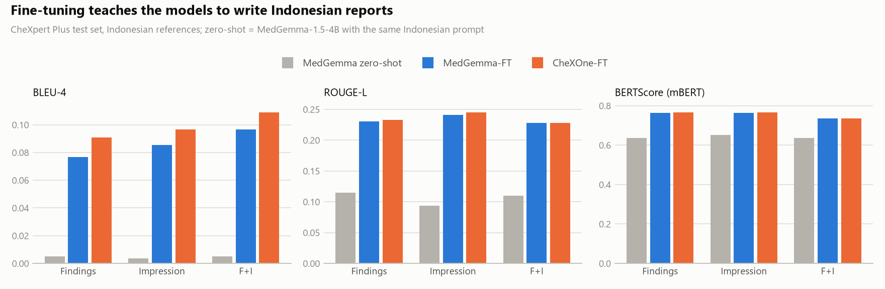
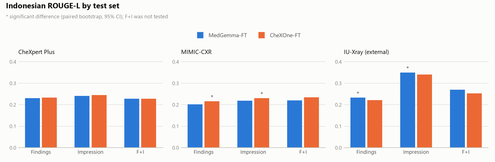
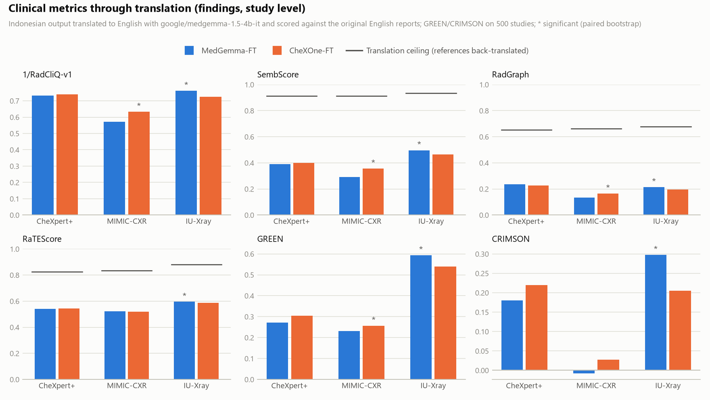
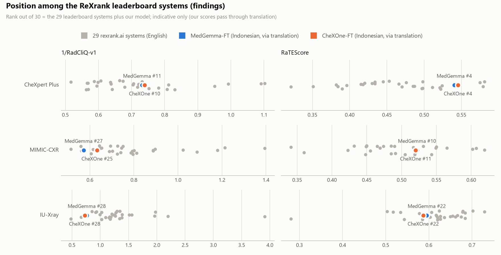

# Indonesian Chest X-Ray Report Generation

[](https://doi.org/10.5281/zenodo.23641847)

Fine-tuning medical vision–language models to write chest X-ray (CXR) radiology reports in
**Bahasa Indonesia**: the findings (*TEMUAN*) and impression (*KESAN*) sections, directly from
the image. To our knowledge this is the first study of CXR report generation in Indonesian.

- **Data:** the reports of CheXpert Plus, MIMIC-CXR and IU-Xray translated into Indonesian with
  TranslateGemma-4B (238,274 images, patient-disjoint splits, IU-Xray as an external test set).
- **Models:** a medical generalist (MedGemma-1.5-4B) and a CXR specialist (CheXOne, 3B), both
  fine-tuned with the same QLoRA recipe on one 16 GB consumer GPU.
- **Evaluation:** Indonesian text metrics, plus the clinical metrics of the
  [ReXrank](https://rexrank.ai) leaderboard computed on English translations of the outputs,
  with a translation-noise ceiling.

Detailed methodology (in Indonesian): [METODOLOGI_FINETUNING.md](METODOLOGI_FINETUNING.md) ·
all numbers: [results/RESULTS.md](results/RESULTS.md)

```
CXR image ──► vision encoder (frozen) ──► projector (frozen) ──► language model (4-bit + LoRA) ──► Indonesian report
                                           prompt: task (TEMUAN / KESAN) + projection
```

## Results

<picture>
  <source media="(prefers-color-scheme: dark)" srcset="results/figures/fig1_finetuning_effect_dark.png">
  
</picture>

<picture>
  <source media="(prefers-color-scheme: dark)" srcset="results/figures/fig2_indonesian_rougeL_dark.png">
  
</picture>

<picture>
  <source media="(prefers-color-scheme: dark)" srcset="results/figures/fig3_clinical_metrics_dark.png">
  
</picture>

<picture>
  <source media="(prefers-color-scheme: dark)" srcset="results/figures/fig4_leaderboard_position_dark.png">
  
</picture>

Findings track, study level (ReXrank metrics computed on ID→EN translations; † significant,
paired bootstrap 95% CI):

| Test set | Model | ROUGE-L (ID) | 1/RadCliQ | RaTEScore | GREEN | CRIMSON |
|---|---|---|---|---|---|---|
| CheXpert Plus | MedGemma-FT | 0.230 | 0.732 | 0.541 | 0.272 | 0.180 |
| | CheXOne-FT | 0.233 | 0.740 | 0.545 | 0.305 | 0.219 |
| MIMIC-CXR | MedGemma-FT | 0.201 | 0.572 | 0.522 | 0.230 | −0.008 |
| | CheXOne-FT | **0.216**† | **0.633**† | 0.520 | **0.257**† | 0.028 |
| IU-Xray (external) | MedGemma-FT | **0.232**† | **0.761**† | **0.595**† | **0.594**† | **0.298**† |
| | CheXOne-FT | 0.221 | 0.725 | 0.587 | 0.540 | 0.205 |

- Fine-tuning is essential: zero-shot MedGemma reaches ROUGE-L 0.115 on CheXpert Plus findings,
  the fine-tuned models 0.230–0.233.
- The specialist (CheXOne) is better on the datasets in its English post-training data
  (MIMIC-CXR, CheXpert Plus impressions); the generalist (MedGemma) is better on every clinical
  metric of the unseen IU-Xray hospital.
- Through translation, both Indonesian models rank 4th (RaTEScore) and 5th (RadGraph) of 30
  systems on CheXpert Plus findings. Ranks are indicative: the leaderboard systems write English.

## Repository layout

```
├── prepare_data.py        1. datasets + Indonesian translations -> data/manifest.parquet
├── train.py               2. QLoRA fine-tuning (--model medgemma | chexone | qwen2.5-vl-3b)
├── infer.py               3. report generation (+ repetition clean-up)
├── evaluate.py            4. Indonesian metrics (0-1 scale)
├── rrg/                   shared library: config, model registry, prompts, text cleaning, data, metrics
├── tools/                 checks, data analysis, paired bootstrap, memorization check, results export
├── scripts/eval_run.sh    inference -> Indonesian metrics -> ID->EN translation -> ReXrank, per run
├── rexrank_eval/          ReXrank metrics on English translations (own uv environment)
├── deploy/cxr_report_id/  stand-alone inference package (transformers + peft, FastAPI example)
└── results/               public, text-free results and figures (tools/export_results.py)
```

Not in the repository: datasets, translations, predictions, checkpoints and adapter weights
(see [Data and licences](#data-and-licences)).

## Base models (`rrg/models.py`)

| `--model` | Hugging Face id | what it is | image input | `max_new_tokens` |
|---|---|---|---|---|
| `medgemma` | google/medgemma-1.5-4b-it | Gemma 3 4B, medical generalist, multilingual | 224 → 896 by its processor | 256 |
| `chexone` | StanfordAIMI/CheXOne | Qwen2.5-VL-3B post-trained on 14.7M CXR samples; English; **CC BY-NC 4.0** | resized to 448 | 352 |
| `qwen2.5-vl-3b` | Qwen/Qwen2.5-VL-3B-Instruct | CheXOne's general-domain base (optional control) | resized to 448 | 352 |

Kept identical across models so that differences come from the base model: the same samples
in the same order, prompts, LoRA and optimizer settings, 256 visual tokens per image, the same
~154-word output budget (Qwen's tokenizer needs 2.25 tokens per Indonesian word vs Gemma's
1.66), post-processing and evaluation. `eval_loss` is not comparable across models.

## Splits

| split | source | use |
|---|---|---|
| train_internal | CheXpert Plus train, 85% of patients | train |
| train_mimic | MIMIC-CXR validate (translated) | train (repeated 4×) |
| dev_internal | CheXpert Plus train, 15% of patients | eval_loss / checkpoint selection |
| test_chexpert | CheXpert Plus valid (234 images) | test |
| test_mimic | MIMIC-CXR test (translated) | test |
| test_openi | IU-Xray / OpenI (translated) | external test |

## Setup

```bash
uv sync --python 3.12          # torch 2.11 cu128, unsloth, trl, peft, bitsandbytes
```

Paths to the datasets are set in `rrg/config.py` (`RRG_DATA_ROOT` environment variable,
default `../dataset`). MedGemma is gated on Hugging Face (accept its terms first); CheXOne is not.

## Run order

```bash
# 1. data -> data/manifest.parquet
uv run python prepare_data.py

# 2. CPU pre-flight check of a base model: chat template, prompt masking, image tokens, stop token, lengths
uv run python tools/check_model.py --model chexone --download

# 3. GPU smoke test (a few steps)
uv run python train.py --model chexone --run_name chexone_smoke --max_train_samples 64 --max_steps 5 --eval_samples 16 --eval_steps 5 --freeze_vision
uv run python infer.py --adapter checkpoints/chexone_smoke/final_adapter --split test_chexpert --limit 8

# 4. full training (257,138 samples, 16,072 steps); --dry_run prints counts without a GPU, --resume continues
uv run python train.py --run_name medgemma_full --freeze_vision --mimic_repeat 4 --lora_r 32 --lora_alpha 32
uv run python train.py --model chexone --run_name chexone_full --freeze_vision --mimic_repeat 4 --lora_r 32 --lora_alpha 32

# 5. evaluation of a finished run (bash): inference -> Indonesian metrics -> ID->EN translation -> ReXrank
bash scripts/eval_run.sh chexone_full

# 6. comparisons and public results
uv run python tools/compare_runs.py test_openi                    # paired bootstrap, Indonesian metrics
cd rexrank_eval && uv run python compare_runs.py && cd ..          # paired bootstrap, ReXrank metrics
uv run python tools/check_memorization.py                          # verbatim copies of training reports
uv run python tools/export_results.py                              # -> results/

# single image / zero-shot base model
uv run python infer.py --adapter checkpoints/chexone_full/final_adapter --image_path path/to/cxr.png --view PA
uv run python infer.py --adapter StanfordAIMI/CheXOne --split test_openi --limit 16
```

Training targets go through `rrg.text.clean_target` (drops consult phone lines, attestations,
"communicated to Dr. X" sentences, MIMIC `___` blanks and looping translations); test
references are only normalized (`clean_text`) so metrics stay comparable. Every generation is
post-processed (`rrg/postprocess.py`: repeated sentences, list items and phrase loops removed, an
unfinished last sentence dropped); `evaluate.py --raw` scores the untouched output.

The ReXrank metrics (1/RadCliQ-v1, BLEU-2, BERTScore, SembScore, RadGraph, RaTEScore, GREEN,
CRIMSON) are computed in [`rexrank_eval/`](rexrank_eval/README.md) on MedGemma-1.5-4B's ID→EN
translations against the original English reports. The translation-noise ceiling (the
Indonesian references translated back) is computed once with `rexrank.py --calibration`.

### If you run out of memory or time

- OOM or very slow steps: `--batch_size 1 --grad_accum 16`, or `--freeze_vision`. On Windows set
  NVIDIA Control Panel → "CUDA - Sysmem Fallback Policy" = "Prefer No Sysmem Fallback" so a real
  OOM error appears instead of a silent slowdown.
- Faster/smaller: `--frontal_only`, `--max_train_samples N`; inference `--batch_size 4`.
- Another base VLM: add a `ModelSpec` to `rrg/models.py`, then run `tools/check_model.py --model <key>`.

## Limitations

- The Indonesian corpus is machine-translated and was not validated by radiologists.
- The ID→EN evaluation translator (MedGemma-1.5-4B), the dataset translator (TranslateGemma-4B)
  and MedGemma belong to the Gemma 3 family, which may favour MedGemma in the clinical metrics.
- The small MIMIC-CXR training subset was repeated 4×; part of its reports were memorized and
  reproduced verbatim at test time (`tools/check_memorization.py`). Future runs should not repeat it.
- 224×224 images, one training run per model.
- **Research prototype, not for clinical use.**

## Data and licences

This repository contains code and aggregate results only. The code is released under the
[MIT License](LICENSE).

- **Datasets** must be obtained from their providers under their own terms:
  [MIMIC-CXR](https://physionet.org/content/mimic-cxr/) (PhysioNet credentialed access),
  [CheXpert Plus](https://aimi.stanford.edu/datasets/chexpert-plus) (Stanford AIMI research use
  agreement), [IU-Xray / Open-i](https://openi.nlm.nih.gov/).
- **Indonesian translations, predictions and adapters are not included.** They are derived from
  MIMIC-CXR and CheXpert Plus reports, and the adapters reproduce some MIMIC-CXR training reports
  verbatim, so they may only be shared under the source datasets' terms (e.g. through PhysioNet).
- **Base models:** MedGemma under the Health AI Developer Foundations terms; CheXOne under
  CC BY-NC 4.0 (non-commercial).

## Acknowledgments

Thanks to [@wibotron](https://github.com/wibotron) for the help throughout this research.

## Citation

Paper in preparation. Until it is available, please cite the software archive on Zenodo:

```bibtex
@software{hamzah_indonesian_cxr_rrg_2026,
  author    = {Hamzah, Farhan and Wibowo, Achmad Baihaqie},
  title     = {Indonesian Chest X-Ray Report Generation},
  year      = {2026},
  publisher = {Zenodo},
  doi       = {10.5281/zenodo.23641847},
  url       = {https://doi.org/10.5281/zenodo.23641847}
}
```

This DOI always resolves to the latest version; each release also has its own DOI
(v1.0.0: [10.5281/zenodo.23641848](https://doi.org/10.5281/zenodo.23641848)).
